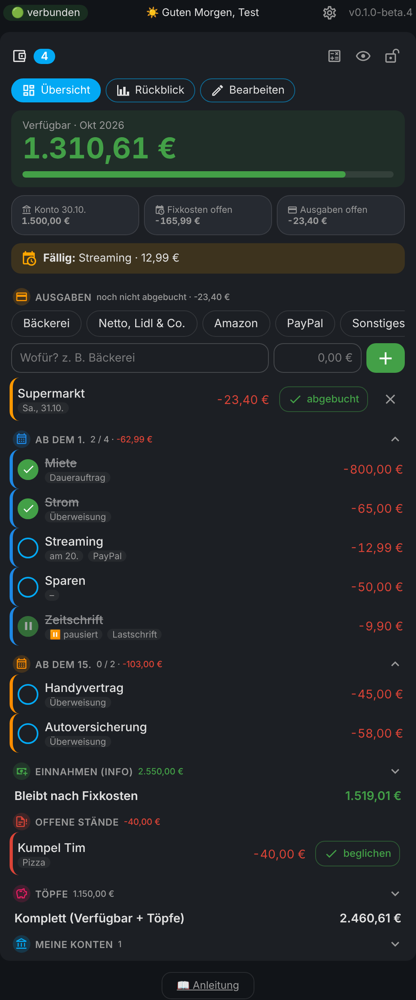

# 💶 Fixed costs for Home Assistant

🇩🇪 **Deutsch?** → [README auf Deutsch](README.md) (the card itself is in German)

**How much money is really left this month?** The card shows exactly that: big and at a glance, in your dashboard, in the sidebar and as a phone app that also works offline.



> 🔒 **Your numbers stay with you.** Everything is stored only in your Home Assistant. No cloud, no third-party server. This repo contains made-up example values only.

---

## ✨ What does it do?

- 💰 **Available** = balance − open fixed costs − payments (card, PayPal, cash …) not yet debited.
- 📋 **Fixed costs in groups** like "from the 1st" and "from the 15th" – collapsible, check them off when debited. Optional fixed day, paused items shown greyed out.
- ⠿ **Reorder everything** by dragging (items also into another group), ↩️ **undo** after deleting.
- 💳 **Card payments** via quick buttons ("bakery 5.75") – subtracted immediately.
- 🧮 **Calculator** at the top of the card, result straight into a payment or the balance.
- 🐷 **Pots**, 🧾 **open balances**, 🏦 **IBAN list** with copy button, 💵 **income** as info.
- 📱 **Offline app** with fingerprint lock and 🔒 **PIN lock** for settings.
- 📊 **Monthly review** for up to 3 years, 📥 **CSV** import and export.

---

## 📦 Installation

1. Open **HACS**, top right **⋮ → Custom repositories**, add `https://github.com/misterm2310/fixkosten-card`, type **Integration**.
2. Search for **Fixkosten**, **Download**, then **restart Home Assistant**.
3. **Settings → Devices & services → Add integration → Fixkosten** → Submit, done. 🎉
4. Dashboard → **Edit → Add card → Fixkosten** (no resource needed, the integration registers it):

```yaml
type: custom:fixkosten-card
privat: true   # optional: hide amounts until 👁️ is tapped
```

---

## 📱 Offline app

<details><summary>The card as a phone app – fingerprint lock, works without network – <i>expand</i></summary>

1. Open `https://YOUR-HA-ADDRESS/fixkosten/app/` in your phone's browser
2. Log in with your Home Assistant user (2FA works too)
3. Browser menu → **"Add to home screen"**
4. Tap **"👆 Fingerabdruck-Sperre einschalten"** at the bottom. After 1 minute in the background the app asks again

Offline, the app shows the last known state. Changes wait in an **outbox** and are sent automatically once Home Assistant is reachable again. Nothing is counted twice. **Logging out** wipes all numbers from the phone.
Behind a reverse proxy only `/fixkosten/*`, `/auth/*` and `/api/*` are needed. Fingerprint requires **https**.

</details>

---

## ⚙️ Settings

<details><summary>Card settings, sidebar, PIN lock and PIN reset – <i>expand</i></summary>

**In the card (⚙️)**, tiles in categories that each open their own window: reset checks at the start of a month (default on), subtract open balances (default off), warning limit, quick buttons (one per line), offline app address with copy button, CSV import/export (admins only) and the 🔒 **PIN lock** (4–8 digits) for ⚙️ and "Bearbeiten". 5 wrong attempts = 1 minute pause.

**In Home Assistant** (Settings → Devices & services → Fixkosten → **Configure**):
- **Show in sidebar** – Fixkosten as its own sidebar entry.
- **Reset PIN** – forgot your PIN? Tick it, save, done (admins only).

The PIN is stored only as a hash and checked by Home Assistant. It guards the display on a shared tablet; admins can still reach everything.

</details>

---

## 🤖 For automations

<details><summary>Sensors and actions – <i>expand</i></summary>

Sensors: `sensor.fixkosten_verfuegbar`, `…_offene_fixkosten`, `…_fixkosten_monat`, `…_einnahmen_monat`, `…_ueberschuss`, `…_ausgaben_offen`, `…_ausgaben_monat`, `…_offene_staende`, `…_gesamtvermoegen`, `…_naechste_abbuchung`, `binary_sensor.fixkosten_warnung`. IBANs never appear in a sensor.

Actions: `fixkosten.abhaken`, `kontostand_setzen`, `buchung_hinzufuegen`, `topf_setzen`, `haken_zuruecksetzen`, `csv_import`, `daten_abrufen`.

</details>

---

## ❓ FAQ

**Where is the data?** Locally in Home Assistant (`/config/.storage/fixkosten`). No cloud. Your HA backups include everything.

**When are new versions released?** Official versions on **Sundays**. On other days only **beta versions**: in HACS, Fixkosten ⋮ → "Redownload" → **"Show beta versions"**.

---

## 💙 Like it?

It is and stays **free**. If you like, you can send me a small voluntary donation via PayPal: [paypal.me/MarcoStrickmann](https://paypal.me/MarcoStrickmann). Thank you! 🙏

[](https://paypal.me/MarcoStrickmann)

---

## 💡 Ideas and bugs

Ideas → [Discussions](https://github.com/misterm2310/fixkosten-card/discussions) · Bugs → [Issues](https://github.com/misterm2310/fixkosten-card/issues). **Please never post real account data!**

License: MIT · by [Mister-M](https://github.com/misterm2310) · Icons in the offline app: [Material Design Icons](https://pictogrammers.com) (Apache 2.0)
