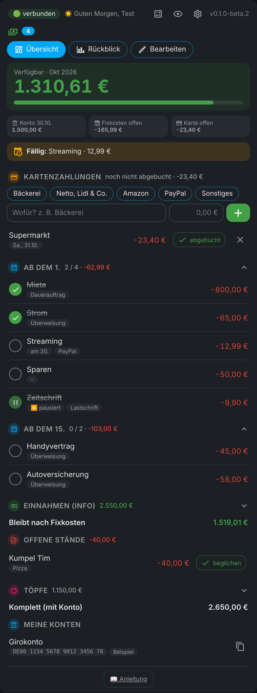

# 💶 Fixkosten für Home Assistant

🇬🇧 **English?** → [README in English](README.en.md)

**Wie viel Geld ist diesen Monat wirklich noch übrig?** Genau das zeigt dir die Karte: groß, auf einen Blick, im Dashboard, in der Seitenleiste und als eigene Handy-App, die auch ohne Netz geht.

Ein Klick öffnet es direkt in deinem Home Assistant: [](https://my.home-assistant.io/redirect/hacs_repository/?owner=misterm2310&repository=fixkosten-card&category=integration) [](https://my.home-assistant.io/redirect/config_flow_start/?domain=fixkosten)



> 🔒 **Deine Zahlen bleiben bei dir.** Alles liegt nur in deinem Home Assistant. Keine Cloud, kein fremder Server. In diesem Repo stehen nur ausgedachte Beispielzahlen.

---

## ✨ Was kann das Ding?

- 💰 **Verfügbar** = Kontostand − offene Fixkosten − Ausgaben, die noch nicht abgebucht sind.
- 📋 **Fixkosten in Gruppen** wie „ab dem 1.“ und „ab dem 15.“ – zum Aufklappen, abhaken, wenn abgebucht. Preis nur diesen Monat anders? Betrag antippen.
- 💳 **Ausgaben** per Schnellknopf („Bäckerei 5,75“) – sofort abgezogen.
- 🧮 **Taschenrechner** oben in der Karte, Ergebnis direkt als Zahlung oder Kontostand. 💡 Knopf, damit der Bildschirm anbleibt.
- 🐷 **Töpfe**, 🧾 **offene Stände**, 🏦 **IBAN-Liste** zum Kopieren, 💵 **Einnahmen** als Info.
- 📱 **Offline-App** mit Fingerabdruck-Sperre und 🔒 **PIN-Sperre** für Einstellungen.
- ⠿ **Alles verschiebbar** (auch in eine andere Gruppe), ↩️ **Rückgängig** nach dem Löschen.
- 📊 **Rückblick** über bis zu 3 Jahre, 📥 **CSV** einlesen und sichern, 📜 **Verlauf** (wer hat wann was geändert).
- 👁️ **Ansicht** wie bei der Einkaufsliste: Abschnitte ausblenden, Beschriftungen, ruhiger Modus – und ein 🐷 **Sparschwein** als Maskottchen, das sich je nach Jahreszeit verkleidet.
- 🌍 **Deutsch oder Englisch** (automatisch wie Home Assistant) und 💱 **Währung wählbar** (Euro, Franken, Dollar, Pfund …).

<details><summary>📋 Alle Funktionen im Detail</summary>

| | |
| --- | --- |
| 💰 **Verfügbar** | Kontostand − offene Fixkosten − Ausgaben, die noch nicht abgebucht sind = was du wirklich ausgeben kannst. Grün im Plus, rot im Minus |
| 📋 **Fixkosten** | In Gruppen wie „ab dem 1.“ und „ab dem 15.“, standardmäßig zugeklappt (Summe und „2 / 4“ stehen im Kopf). Freiwillig ein **fester Tag** (z. B. am 5.) – dann gibt es oben einen Hinweis auf die nächste Abbuchung. Posten nur in bestimmten Monaten (z. B. Kfz-Steuer im März) oder **pausiert** (steht grau und abgehakt drin, zählt nicht mit) |
| ⠿ **Verschieben** | Gruppen, Posten, Töpfe, Einnahmen, offene Stände und Konten am Griff ⠿ ziehen. Posten auch in eine andere Gruppe |
| ↩️ **Rückgängig** | Nach Löschen, „beglichen“ oder „abgebucht“ steht 8 Sekunden lang „Rückgängig“ unten in der Karte |
| 💳 **Ausgaben** | Schnellknopf antippen, Betrag rein, fertig. Taucht es auf dem Konto auf: grüner Haken ✓. Eintrag antippen = ändern. Lange drücken auf einen Symbol-Knopf zeigt, was er macht |
| 🧮 **Taschenrechner** | + − × ÷ %, Taste **V** setzt „Verfügbar“ ein. Ergebnis als Ausgabe, Kontostand oder kopieren. Rechnet selbst, ohne `eval` |
| 💡 **Bildschirm an** | Glühbirne oben zwischen 👁️ und 🔒: einmal antippen, dann geht das Handy nicht aus (z. B. beim Abarbeiten der Rechnungen). Noch mal antippen = wieder normal. In der HA-App hilft nur deren Einstellung „Keep screen On“ |
| 💵 **Einnahmen** | Nur zur Info (Lohn, Nebenjob …), mit Kreis zum Abhaken, sobald sie auf dem Konto sind. Zeigt, was nach den Fixkosten übrig bleibt |
| 🐷 **Töpfe** | Was wo liegt: Sparkonto, Bargeld zu Hause, PayPal … plus „Komplett“ = Verfügbar + alle Töpfe. ➖ Rausnehmen und ➕ Zurücklegen, Geliehenes steht in Orange dabei (im geöffneten Topf antippen = nicht mehr zurücklegen) |
| 🧾 **Offene Stände** | Was du noch begleichen musst (rot) oder bekommst (grün). Zum Zuklappen, beide Summen in der Überschrift, Antippen = Bearbeiten klappt darunter auf, grüner Haken = erledigt. Auf Wunsch bei „Verfügbar“ mitrechnen |
| 🏦 **Meine Konten** | IBAN-Liste zum schnellen Kopieren (📋) |
| 👁️ **Verstecken** | Ein Tipp verschwimmt alle Beträge, z. B. wenn jemand mitschaut |
| 🙈 **Verschleiert** | Die Summen von Einnahmen und Töpfen (in der Überschrift) und „Komplett“ sind verschwommen, die einzelnen Einträge nicht. Am PC Maus drüber, am Handy auf den Betrag drücken = 4 Sekunden sichtbar. Abschaltbar in ⚙️ → Ansicht |
| 🔒 **PIN-Sperre** | ⚙️ und „Bearbeiten“ nur mit PIN. Abhaken und Zahlungen gehen ohne. Auf Wunsch die **ganze Karte** sperren (⚙️ → Schutz): dann sieht man ohne PIN gar nichts |
| 📊 **Rückblick** | Jeder Monat wird am Monatsende automatisch gemerkt (⚙️ → Daten → Rückblick) |
| 🩺 **Gesundheit** | „Alles ok?“ findet Posten ohne Gruppe, alten Kontostand, vergessene Ausgaben …, dazu Fehler-Protokoll und Ressourcen |
| 📱 **Offline-App** | Eigene Handy-App mit Anmeldung, Fingerabdruck/Face-ID-Sperre und Postausgang |
| 📜 **Verlauf** | Wer hat wann was geändert: abgehakt, Kontostand, Ausgaben, Töpfe, Bearbeiten … Die letzten 300 Einträge, ausschaltbar, Admins können ihn leeren (⚙️ → Daten → Verlauf) |
| 👁️ **Ansicht** | Abschnitte für alle ausblenden (Nächste Abbuchung, Ausgaben, Fixkosten, Einnahmen, Offene Stände, Töpfe, Meine Konten), **Beschriftungen** unter den Symbol-Knöpfen, **Ruhiger Modus** (nur dieses Gerät) und in der Offline-App **Hell / Dunkel** |
| 🐷 **Maskottchen** | Ein Sparschwein oben links (Standard aus): freut sich im Plus, guckt skeptisch knapp über der Warngrenze, erschrickt im Minus und hüpft, wenn alle Fixkosten abgehakt sind. Morgens gähnt es, ab 21 Uhr schläft es. Kostüme je nach Datum: Blume (Frühling), Sonnenbrille (Sommer), Blatt (Herbst), Schal (Winter), Hasenohren (Ostern), Kürbis (Halloween), Mütze (Advent), Partyhut (Silvester) |
| 💱 **Währung** | ⚙️ → Rechnen & Warnung: Euro, Schweizer Franken, US-Dollar, Pfund, Złoty, Kronen, Forint. Ändert nur Zeichen und Schreibweise (CHF 1’234.50), es wird nichts umgerechnet. Die Sensoren nehmen die Währung mit |
| 🌍 **Sprache** | Deutsch oder Englisch – automatisch wie Home Assistant, oder fest mit `language:` in der Karte. Deine eigenen Namen werden nie übersetzt |
| 📖 **Anleitung** | Steckt direkt in der Karte (unten „📖 Anleitung“) |

</details>

---

## 📦 Installation

> 💡 **Ab Home Assistant 2026.11** ist HACS in Home Assistant eingebaut und heißt **Einstellungen → Marketplace**. Die Schritte sind dieselben, nur der Weg dahin ist neu.

1. **HACS** öffnen, oben rechts **⋮ → Benutzerdefinierte Repositories**, `https://github.com/misterm2310/fixkosten-card` eintragen, Typ **Integration**, **Hinzufügen**.
2. Nach **Fixkosten** suchen, **Herunterladen**, danach **Home Assistant neu starten**.
3. **Einstellungen → Geräte & Dienste → Integration hinzufügen → Fixkosten** → Absenden, fertig. 🎉 (Hier kannst du auch gleich „In der Seitenleiste anzeigen“ anhaken.)
4. Dashboard → **Bearbeiten → Karte hinzufügen → Fixkosten**.

```yaml
type: custom:fixkosten-card
```

> 🙌 Eine Ressource musst du **nicht** von Hand eintragen, das macht die Integration selbst.
> Sieht die Karte nach einem Update komisch aus? In der App einmal nach unten ziehen oder im Browser Strg+F5.

<details><summary>Ohne HACS (von Hand)</summary>

Den Ordner `custom_components/fixkosten` nach `/config/custom_components/fixkosten` kopieren und Home Assistant neu starten. Dann weiter mit Schritt 3.
</details>

---

## 👆 So wird's benutzt

<details><summary>Kontostand, abhaken, Ausgaben, Rechner und Bearbeiten – <i>aufklappen</i></summary>

1. **Kontostand eintragen:** Kachel „Konto“ antippen, Stand aus der Bank-App eingeben.
2. **Abhaken:** Gruppe aufklappen (Tipp auf die Überschrift). Ist ein Posten abgebucht, den Kreis antippen ✅. Am Monatsanfang gehen die Haken von selbst wieder auf (Schalter in ⚙️).
   **Preis nur diesen Monat anders?** Hinten auf den Betrag tippen – nächsten Monat gilt wieder der gespeicherte Preis.
3. **Etwas bezahlt (Karte, PayPal, bar …)?** Schnellknopf (z. B. „Bäckerei“), Betrag, **＋**. Sofort abgezogen. Später den grünen Haken ✓ tippen.
4. **Rechnen:** Oben auf 🧮. Ergebnis per Tipp als Ausgabe, Kontostand oder kopieren.
5. **Anlegen und ändern:** Reiter **„Bearbeiten“** → ＋ Neu oder Eintrag antippen. Reihenfolge am Griff ⠿ vorne. Ausgabe antippen = Name und Betrag ändern.
6. **Versehentlich gelöscht?** Unten auf **„↩️ Rückgängig“** tippen.

Alles Weitere steht in der Karte unter **📖 Anleitung** – einfach aufklappen.

</details>

---

## 📱 Offline-App

<details><summary>Die Karte als App aufs Handy – mit Fingerabdruck, geht auch ohne Netz – <i>aufklappen</i></summary>

1. Am Handy im Browser öffnen: `https://DEINE-HA-ADRESSE/fixkosten/app/`
2. Mit deinem Home-Assistant-Benutzer anmelden (2-Faktor geht auch)
3. Im Browser-Menü **„Zum Startbildschirm“** – schon gibt es ein eigenes App-Symbol
4. Unten **„👆 Fingerabdruck-Sperre einschalten“** (der Knopf erscheint nur, wenn dein Handy Fingerabdruck oder Face ID kann). Nach 1 Minute im Hintergrund fragt die App wieder

**Ohne Netz?** Die App zeigt den zuletzt bekannten Stand. Was du einträgst oder abhakst, wartet im **Postausgang** (oben „⏳ wartet“) und wird von selbst nachgeschickt, sobald Home Assistant wieder erreichbar ist. Nichts zählt doppelt.

**Ehrlich gesagt:** Die Fingerabdruck-Sperre ist eine Sperre vor der Anzeige, kein Tresor. **Abmelden** löscht nur die Kopie im Handy, deine Daten in Home Assistant bleiben erhalten.

Hinter einem Reverse Proxy werden nur `/fixkosten/*`, `/auth/*` und `/api/*` gebraucht. Fingerabdruck geht nur über **https**.

</details>

---

## ⚙️ Die Einstellungen

<details><summary>Zahnrad in der Karte, Seitenleiste, PIN-Sperre und PIN zurücksetzen – <i>aufklappen</i></summary>

**In der Karte (⚙️)** – wie bei der Einkaufsliste: Kästen nach Zweck zum Aufklappen, jede Zeile öffnet eine eigene Seite in der Karte (← zurück). Die PIN tippst du auf einem Zahlenfeld wie am Handy:
- 🧮 **Rechnen & Warnung:** Haken am Monatsanfang automatisch zurücksetzen (Standard an), offene Stände von „Verfügbar“ abziehen (Standard aus), Warnung an/aus und Warngrenze, 💱 Währung
- ⚡ **Schnellknöpfe** für Ausgaben – wie die Kategorien der Einkaufsliste: Liste mit Farbe und Symbol, ⠿ ziehen = Reihenfolge, ＋ Neu, antippen = Name, Farbe und Symbol ändern, 🗑️ löschen mit Rückgängig
- 💾 **Daten:** Import & Sicherung (CSV einlesen und sichern, nur Admins), 📜 Verlauf (an/aus, leeren), 📊 Rückblick, 💣 Werkseinstellungen (nur Admins, zwei Sicherheitsfragen, nur die PIN bleibt)
- 🩺 **Gesundheit:** Alles ok?, Fehler-Protokoll, Ressourcen
- 👁️ **Ansicht:** Ansicht für alle (Abschnitte ein-/ausblenden, Einnahmen/Töpfe/Komplett verschleiern), Beschriftungen, Maskottchen (alle drei gelten für alle Geräte), Ruhiger Modus (nur dieses Gerät), in der Offline-App Hell / Dunkel
- 📱 **Offline-App:** Anleitung und deine eigene App-Adresse mit „Kopieren“
- 🔒 **Schutz** (4–8 Ziffern): Dann fragen ⚙️ und „Bearbeiten“ nach der PIN – mit dem Schalter „Ganze Karte sperren“ sogar die ganze Karte (in der Offline-App mit Fingerabdruck reicht der Fingerabdruck). Das 🔓 oben sperrt sofort wieder, sonst nach 10 Minuten Ruhe. 5× falsch = 1 Minute Pause. Entsperren klappt auch offline.
- 🛡️ Datenschutz, 🆕 Was ist neu und 💙 Credits

**In Home Assistant** (Einstellungen → Geräte & Dienste → Fixkosten → **Konfigurieren**):
- **In der Seitenleiste anzeigen** – Fixkosten als eigener Eintrag links, ganz ohne Dashboard.
- **PIN zurücksetzen** – PIN vergessen? Haken setzen, speichern, PIN ist weg. Das geht nur als Admin.

<details><summary><b>🔐 Ehrlich zur Sicherheit</b></summary>

Die PIN liegt nur als Prüfsumme in Home Assistant und wird dort geprüft. Ohne Netz prüft die Karte selbst mit einem stark verwürfelten Offline-Schlüssel (nie die PIN selbst) – dafür die PIN nach dem Einschalten einmal mit Netz eintippen. Sie schützt die Anzeige von ⚙️ und „Bearbeiten“ vor neugierigen Fingern am Wand-Tablet. Wer Admin in Home Assistant ist, kommt trotzdem an alles – das ist so gewollt.

</details>

<details><summary><b>📥 CSV-Datei</b></summary>

Spalten (Semikolon): `Typ;Name;Betrag;Gruppe/Datum;Zahlart;Notiz`

| Typ | Bedeutung | Spalte 4 |
| --- | --- | --- |
| `ausgabe` | Fixkosten-Posten | Gruppe: `1`, `15` (oder Name). Neue Starttage legen eine Gruppe an |
| `einnahme` | Einnahme (nur Info) | Datum als Text |
| `topf` | Stand eines Topfs | Datum der letzten Änderung (`TT.MM.JJJJ`, optional) |
| `stand` | offener Stand – ich muss zahlen | Datum (optional) |
| `forderung` | offener Stand – ich bekomme | Datum (optional) |
| `iban` | Konto-Info, IBAN steht in Spalte 3 | – |
| `kontostand` | Kontostand (darf negativ sein) | Datum (optional) |

Zahlart-Kürzel: `ü` Überweisung · `d` Dauerauftrag · `l` Lastschrift · `p` PayPal · `a` Amex · `g` Google · `b` Bar · `-` keine.
Beträge gehen deutsch (`1.234,56 €`) oder mit Punkt. Minus wird ignoriert (außer beim Kontostand). Beispiel: [beispiel-fixkosten.csv](beispiel-fixkosten.csv)

Einlesen: in der Karte unter ⚙️ (nur Admins) oder per Aktion `fixkosten.csv_import` mit `datei: fixkosten.csv` (im config-Ordner).

</details>

<details><summary><b>🗓️ Monatswechsel</b></summary>

Am 1. eines Monats um 00:00 merkt sich die Integration den alten Monat für den Rückblick. Ist der Schalter **„Haken am Monatsanfang automatisch zurücksetzen“** (⚙️, Standard an) eingeschaltet, sind danach alle Haken wieder offen. Ist er aus, bleiben die Haken stehen, bis du sie selbst zurücksetzt. Posten können auf bestimmte Monate beschränkt werden (z. B. Kfz-Steuer nur im März) oder pausiert werden.

</details>

</details>

---

## 🎛️ Karten-Optionen

<details><summary>Was du im YAML der Karte einstellen kannst – <i>aufklappen</i></summary>

```yaml
type: custom:fixkosten-card
title: Fixkosten   # optional
buch: Partnerin    # optional: welches Buch (leer = erstes Buch), auch im Karten-Editor wählbar
privat: true       # optional: Beträge erst nach Antippen von 👁️ zeigen (z. B. fürs Küchen-Tablet)
language: en       # optional: de oder en (ohne = wie Home Assistant), auch im Karten-Editor wählbar
```

</details>

---

## 🤖 Für Automationen

<details><summary>Sensoren und Aktionen – <i>aufklappen</i></summary>

| Entität | Inhalt |
| --- | --- |
| `sensor.fixkosten_verfuegbar` | Was wirklich noch da ist (Attribute: Kontostand, offene Fixkosten, Ausgaben offen, Monat) |
| `sensor.fixkosten_offene_fixkosten` | Summe der offenen Posten (Attribute: Anzahl, Namen, Gruppen) |
| `sensor.fixkosten_fixkosten_monat` | Alle Fixkosten dieses Monats |
| `sensor.fixkosten_einnahmen_monat` | Einnahmen (Info) |
| `sensor.fixkosten_ueberschuss` | Einnahmen − Fixkosten |
| `sensor.fixkosten_ausgaben_offen` | Noch nicht abgebuchte Ausgaben |
| `sensor.fixkosten_ausgaben_monat` | Alle Ausgaben dieses Monats |
| `sensor.fixkosten_offene_staende` | Summe der offenen Stände, die du noch zahlen musst |
| `sensor.fixkosten_offene_staende_ich_bekomme` | Summe der offenen Stände, die du noch bekommst („Ich bekomme“) |
| `sensor.fixkosten_gesamtvermoegen` | Verfügbar + alle Töpfe |
| `sensor.fixkosten_naechste_abbuchung` | Name des nächsten offenen Postens (Attribute: Betrag, Gruppe, ab Tag, fällig) |
| `binary_sensor.fixkosten_warnung` | An, wenn „Verfügbar“ unter der Grenze aus ⚙️ liegt |

IBANs tauchen bewusst in keinem Sensor auf. Weitere Bücher bekommen den Namen dazwischen, z. B. sensor.fixkosten_partnerin_verfuegbar.

| Aktion | Was sie tut |
| --- | --- |
| `fixkosten.abhaken` | `name`, `erledigt` (Standard an): Posten für diesen Monat abhaken |
| `fixkosten.kontostand_setzen` | `kontostand` |
| `fixkosten.buchung_hinzufuegen` | Ausgabe: `name`, `betrag` |
| `fixkosten.topf_setzen` | `name`, `betrag` (legt den Topf an, wenn es ihn nicht gibt) |
| `fixkosten.haken_zuruecksetzen` | Alle Haken dieses Monats weg |
| `fixkosten.csv_import` | `text` oder `datei`, optional `ersetzen` |
| `fixkosten.daten_abrufen` | Gibt alle Zahlen zurück (für Skripte) |

Alle Aktionen haben zusätzlich `buch` (z. B. `Partnerin`). Leer = erstes Buch.

</details>

---

## 📚 Mehrere Bücher (z. B. eins pro Person)

<details><summary>Wie bei mehreren Anlagen: jeder seine eigene Liste – <i>aufklappen</i></summary>

1. **Einstellungen → Geräte & Dienste → Fixkosten → Eintrag hinzufügen**, Namen eingeben (z. B. „Partnerin“).
2. Neue Karte anlegen, im Karten-Editor bei **„Welches Buch?“** das Buch wählen (oder `buch: Partnerin` im YAML).
3. In der Karte unter **Sichtbarkeit** nur den passenden Benutzer anhaken – dann sieht jeder nur sein Buch.

Jedes Buch hat **eigene** Fixkosten, Töpfe, Kontostand, PIN, Rückblick und Sensoren (`sensor.fixkosten_partnerin_…`). Das erste Buch bleibt genau wie bisher. Offline-App für ein anderes Buch: Adresse mit `?buch=Partnerin` öffnen (steht in dem Buch unter ⚙️ → Offline-App). Ein Buch löschen = Eintrag löschen, seine Daten gehen mit.

**Ehrlich:** Das ist Ordnung, kein Tresor – ein HA-Admin kann technisch alle Bücher sehen.

</details>

---

## ❓ Häufige Fragen

**Wo liegen die Daten?** Lokal in Home Assistant (`/config/.storage/fixkosten`). Keine Cloud. Deine HA-Backups sichern alles mit, dazu gibt's ⚙️ → „Als CSV sichern“.

**Die Karte sagt „Ist die Integration eingerichtet?“.** Dann fehlt Schritt 3 der Installation.

**Wann kommen neue Versionen?** Offizielle Versionen immer **sonntags**. An den anderen Tagen gibt es nur **Test-Versionen (Beta)**. Die siehst du in HACS, wenn du bei Fixkosten ⋮ → „Neu herunterladen“ wählst und **„Beta-Versionen anzeigen“** einschaltest. Eine Beta kann noch Ecken und Kanten haben; die Version steht oben rechts in der Karte.

**PIN vergessen?** Einstellungen → Geräte & Dienste → Fixkosten → Konfigurieren → „PIN zurücksetzen“.

**Holt die Karte meine Umsätze von der Bank?** Nein, mit Absicht. Kontostand und Zahlungen trägst du selbst ein – dafür geht nichts an fremde Server.

---

## 💙 Gefällt dir die Fixkosten-Karte?

Sie ist und bleibt **kostenlos**. Wenn du magst, kannst du mir ganz freiwillig eine kleine Spende per PayPal schicken: [paypal.me/MarcoStrickmann](https://paypal.me/MarcoStrickmann). Den Link gibt es auch unter ⚙️ → Credits. Danke! 🙏

[](https://paypal.me/MarcoStrickmann)

---

## 💡 Ideen, Wünsche und Fehler

- **Idee oder Wunsch?** Schreib sie bei den [Diskussionen](https://github.com/misterm2310/fixkosten-card/discussions).
- **Etwas funktioniert nicht?** Mach ein [Issue](https://github.com/misterm2310/fixkosten-card/issues) auf. Hilfreich: deine Version (steht oben rechts in der Karte), was du getan hast und was passiert ist. **Bitte keine echten Kontodaten mitschicken!**

---

## 🧪 Für Entwickler

<details><summary>Tests – <i>aufklappen</i></summary>

```bash
pip install -r requirements_test.txt
pytest
```

Dazu gibt es einen **Oberflächen-Test** im Browser (Rechnen, Offline-Postausgang, Taschenrechner, PIN, Anleitung, Offline-App): `cd tests/ui && npm install && npx playwright install chromium && node ui.test.mjs`. Er läuft bei GitHub bei jeder Änderung automatisch mit.

</details>

Lizenz: MIT · von [Mister-M](https://github.com/misterm2310) · Symbole in der Offline-App: [Material Design Icons](https://pictogrammers.com) (Apache 2.0)
